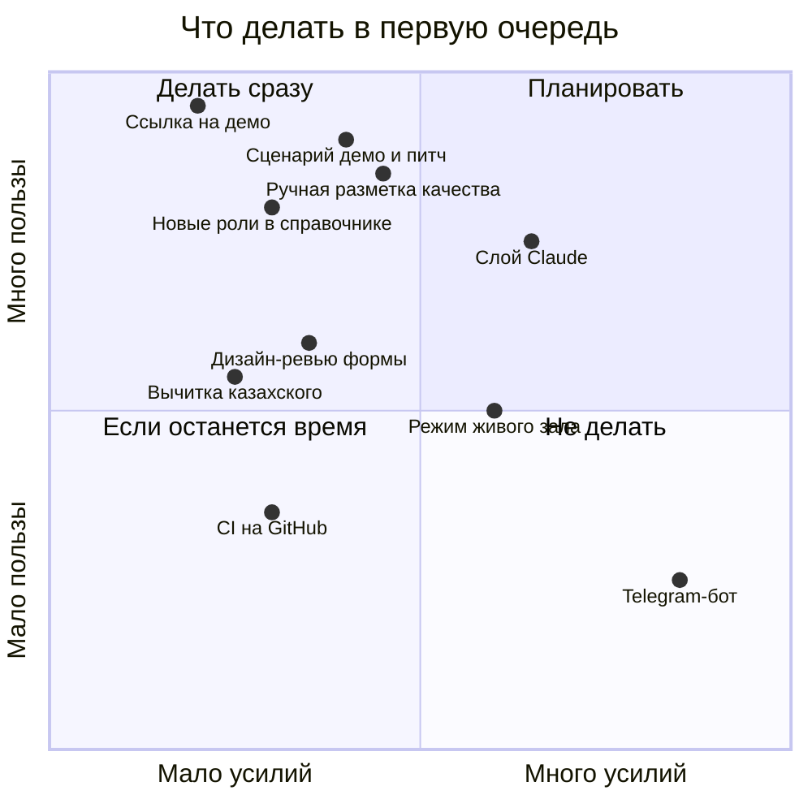

# Шаг 1. Продуктовый бриф MeetMatch

> **Роль:** продакт-менеджер · **Дата:** 20 ноября 2026 · **Статус:** утверждён командой
> **Техники:** problem statement, персоны и Jobs-to-be-Done, user stories с критериями приёмки (Given/When/Then), MoSCoW, матрица «польза / усилия», North Star Metric, реестр рисков, разбор под критерии жюри.

---

## 1. Проблема

> На IT-митапы приходит 300+ человек, но знакомства случайны. Соискатель уходит, так и не поговорив с компанией, которая нанимает его роль. Рекрутер не находит кандидатов в зале. Джун не встречает ментора, который стоял в двух метрах.

**Чего это стоит:** организатор теряет главную ценность мероприятия — полезные знакомства. Участники не возвращаются, спонсоры не видят отдачи от стендов.

**Наше решение одной фразой:** по короткой анкете за секунду показываем 5 человек, которым вы нужны так же, как они вам, объясняем почему и даём первую фразу для знакомства.

## 2. Для кого: персоны и их «работы» (JTBD)

| Персона | Цель в анкете | Работа, которую «нанимает» продукт | Что для неё «успех» |
|---|---|---|---|
| **Айгерим**, джун Python, 1 год опыта | Найти работу | «Когда я на митапе, хочу быстро понять, какие компании нанимают мою роль, чтобы не тратить вечер на случайные разговоры» | 2–3 разговора с нанимающими, чей стек совпадает |
| **Ерлан**, IT-рекрутер маркетплейса | Нанять | «Хочу за вечер найти 3–5 подходящих кандидатов в зале, а не разбирать 300 бейджей» | Список кандидатов нужной роли и уровня с общим временем для встречи |
| **Дана**, студентка, хочет в аналитику | Найти ментора | «Хочу найти человека, который прошёл мой путь и ответит на вопросы» | Ментор из своей области, опытнее и с готовой первой фразой: не страшно подойти |
| **Тимур**, сеньор DevOps | Стать ментором | «Хочу помочь тем, кому мой опыт реально нужен» | Подопечные из его области, а не случайные люди |
| **Мадина**, фаундер с идеей в финтехе | Найти кофаундера | «Мне нужен технический партнёр, а не ещё один бизнес-человек» | Разработчики, которые тоже ищут кофаундера |
| **Организатор** | — (дашборд) | «Хочу видеть, кто в зале и чего не хватает, чтобы следующее мероприятие было лучше» | Баланс спроса и предложения, популярные темы, отзывы о знакомствах |
| **Партнёр со стендом** | — | «Хочу, чтобы к стенду подходили нужные люди» | Рекомендация стенда подходящим участникам |

## 3. Ценностное предложение и отличие

| | Обычный митап | Платформы для конференций (Brella, Grip, Swapcard) | **MeetMatch** |
|---|---|---|---|
| Порог входа | — | Регистрация, профиль, приложение | **Анкета за 1 минуту, без регистрации** |
| Взаимность целей | Нет | Частично | **Жёсткое правило:** соискателю показываем только нанимающих |
| Объяснение «почему он» | Нет | Обычно процент совпадения | **1–2 предложения с фактами** + первая фраза |
| Казахский язык | — | Как правило, нет | **Интерфейс, объяснения и понимание текста на kk / ru / en** |
| Ценность для организатора | Нет | Аналитика | **Подсказки:** «соискателей в 1,3 раза больше, позовите компании» |

## 4. Пользовательские истории и критерии приёмки

Приоритеты по **MoSCoW**: Must — без этого не допускают к призам, Should и Could — из кейса, Won't — сознательно не делаем.

| ID | История | Критерий приёмки (Given / When / Then) | Статус |
|---|---|---|---|
| **M1** | Как участник, я заполняю анкету: роль, стек, опыт, интересы, «о себе», цель | **Given** открыт сайт, **when** я заполняю поля и жму «Подобрать», **then** анкета принимается, даже если заполнены только роль и цель | ✅ |
| **M2** | Как участник, я получаю 5 человек с объяснением в 1–2 предложениях | **Then** ровно 5 карточек, в каждой 1–2 предложения с конкретными фактами | ✅ проверено тестом |
| **M3** | Как соискатель, я вижу только тех, кто нанимает | **Then** ни одного соискателя в выдаче; ментор всегда опытнее подопечного | ✅ проверено на всех 200 анкетах |
| **M4** | Как участник, я пользуюсь веб-страницей | **Given** ссылка для жюри, **then** сайт открывается с ноутбука и телефона | ⚠️ работает локально, ссылки ещё нет (шаг 7) |
| **M5** | Как жюри, я вижу базу 100+ синтетических анкет | **Then** файлы CSV и JSON в репозитории, имена вымышлены | ✅ 200 анкет |
| **S1** | Как казахоязычный участник, я пользуюсь сервисом на своём языке | **Then** интерфейс, объяснения и первая фраза на kk / ru / en; текст «о себе» понимается на всех трёх | ✅ нужна вычитка носителем (шаг 2) |
| **S2** | Как стеснительный участник, я получаю первую фразу | **Then** у каждой карточки фраза с общей темой и кнопка «копировать» | ✅ |
| **S3** | Как участник, я отмечаю «познакомились / не подошло» | **Then** список пересчитывается, отклонённый не возвращается | ✅ |
| **C1** | Как участник, я получаю расписание встреч 1:1 | **Then** встречи в общих свободных слотах, без накладок | ✅ |
| **C2** | Как организатор, я вижу карту интересов зала | **Then** дашборд со спросом и предложением, картой интересов и подсказками | ✅ |
| **C3** | Как участник, я вижу подходящие стенды | **Then** 2 стенда под анкету | ✅ |
| **W** | Регистрация, база данных, Telegram-бот, своя ML-модель, парсинг LinkedIn | Баллов за это нет, а риск не успеть высокий. Парсинг прямо запрещён | ❌ не делаем |

## 5. Метрики успеха

**North Star Metric — доля полезных знакомств:** сколько рекомендаций из 5 человек признаёт подходящими. Это прямо то, что жюри проверит на своих 3 анкетах.

| Метрика | Требование кейса | Наша цель | Сейчас |
|---|---|---|---|
| Подходящих рекомендаций из 5 | ≥ 3 | **≥ 4** | **4,9 по ручной разметке**; ≥ 3 из 5 — у 100% анкет (шаг 4) |
| Время подбора | < 3 с | < 0,1 с | 1–3 мс |
| Путь «анкета → результат» | ≤ 2 мин | ≤ 60 с | ~10 с с примером; без примера не замеряли (шаг 8) |
| Цели, у которых есть 5 взаимных кандидатов | — | 100% | 100% |
| Доля «познакомились» среди отзывов | — | показываем на дашборде | 0 (пока нет пользователей) |

## 6. Разбор под критерии жюри (100 баллов)

| Критерий | Баллы | Как жюри проверяет | Где можем потерять | Что делаем | Шаг |
|---|---|---|---|---|---|
| Качество рекомендаций | **30** | Вводит 3 свои анкеты | Роль не из нашего списка (Data Engineer, Security, Gamedev, CTO); необычный текст; редкий стек | Расширить справочники, ручная разметка качества, слой Claude для свободного текста | 3, 4, 9 |
| Работоспособность Must | **25** | 5 пунктов по 5 баллов | Нет ссылки на демо; демо упадёт на питче | Streamlit Cloud + локальный запуск + видео как запасной вариант | 7, 10 |
| Объяснения и удобство | **15** | Проходит путь «анкета → результат» за 2 мин | Шаблонные объяснения выглядят однообразно; форма длинная | Дизайн-ревью формы, живые объяснения от Claude | 2, 6, 9 |
| Should и Could | **15** | Наличие и работа функций | Казахский с ошибками | Вычитка, проверка каждой функции | 2, 8 |
| Питч до 7 мин с живым демо | **15** | Выступление | Не уложимся во время; демо без сценария | Сценарий демо на 3 персоны, репетиция с таймером | 10 |

## 7. Реестр рисков

| Риск | Вероятность | Влияние | Что делаем |
|---|---|---|---|
| Жюри введёт роль, которой нет в списке (например, Data Engineer) | Высокая | Высокое | Шаг 3: добавить роли и маппинг близких ролей |
| Анкета только на казахском со словами вне словаря | Средняя | Среднее | Шаг 3: расширить словарь; шаг 9: Claude понимает любой текст |
| Streamlit Cloud «уснул» перед питчем | Средняя | Высокое | Шаг 7: деплой; шаг 10: открыть ссылку за 10 минут до выступления, держать локальный запуск |
| Нет интернета на площадке | Низкая | Высокое | Локальный запуск без интернета (ИИ-слой с откатом на шаблоны) + видео |
| Не успеем всё до 09:00 | Средняя | Высокое | Порядок шагов по ценности; стоп новым функциям в 01:30 |
| Ключ API попадёт в репозиторий | Низкая | Высокое | `.env` в `.gitignore`, секреты Streamlit; проверка перед пушем (шаги 7 и 9) |
| ИИ-слой нестабилен к концу ночи | Средняя | Среднее | Шаг 9 последним из функций; откат на шаблоны; флаг выключения; стоп новым функциям в 01:30 |

## 8. Матрица «польза / усилия» для оставшихся работ

**Новая идея команды — «режим живого зала».** Анкета участника добавляется в общую базу, и следующие участники видят его в рекомендациях. На питче это эффект «вау»: если двое из жюри введут анкеты рекрутера и соискателя, система познакомит их друг с другом. Делаем на шагах 5–6.

## 9. План: 10 шагов до сдачи

Каждый шаг выполняет Claude в роли профессионала, команда проверяет. Ключ API Claude добавляем в конце (шаг 9), когда всё остальное готово.

| # | Роль | Что делаем | Результат | Кто проверяет | Время |
|---|---|---|---|---|---|
| 1 | Продакт-менеджер | Персоны, истории, метрики, риски, бэклог | этот документ ✅ | Питчер | 16:00–16:15 |
| 2 | UX/UI-дизайнер | Путь пользователя, эвристики Нильсена, дизайн-токены, контраст WCAG, UX-тексты на 3 языках | `docs/02-design.md`, тема и тексты | Разработчик 2 + питчер с секундомером | 16:15–17:15 |
| 3 | Data-инженер | Новые роли и стек, казахские синонимы, валидатор данных, карточка датасета | `taxonomy.py`, `data/`, `scripts/validate_data.py`, `docs/03-data-card.md` | Разработчик 1 | 17:15–18:00 |
| 4 | ML-инженер | Ручная разметка, Precision@5, nDCG@5, доля «≥ 3 из 5», подбор весов, разбор ошибок | `tests/labels.csv`, `scripts/evaluate.py`, `docs/04-evaluation.md` | Все трое + **ментор до 21:00** | 18:00–19:30 |
| 5 | Backend-разработчик | Конфигурация, логирование, отзывы на диске, режим живого зала, проверка на 1 000 анкет | `config.py`, новые тесты | Разработчик 1 | 19:30–20:30 |
| 6 | Frontend-разработчик | Реализация дизайна, адаптивность, доступность, состояния, кнопка «Добавить меня в зал» | финальный интерфейс | Разработчик 2 | 20:30–21:30 |
| 7 | DevOps-инженер | Коммиты, публичный GitHub, CI, `docker compose up`, Streamlit Cloud, проверка README | ссылки на репозиторий и демо | Разработчик 2 | 21:30–22:30 |
| 8 | QA-инженер | Тест-план по требованиям кейса, тестирование «как жюри», баг-репорты, регрессия | `docs/08-test-report.md` | Питчер в роли жюри | 22:30–23:45 |
| 9 | AI-инженер | Слой Claude: 15 кандидатов → 5 лучших с живыми объяснениями, откат на шаблоны, A/B-сравнение | `llm.py`, ключ в секретах | Вся команда | 23:45–01:00 |
| 10 | Питчер | ≤ 10 слайдов, сценарий демо, видео ≤ 3 мин, ответы на вопросы, чек-лист сдачи | презентация и видео | Питчер: 2 прогона | 01:00–02:30, утром прогон |

**Стоп новым функциям — 01:30.** Утром 07:00–08:00 — прогон питча, 08:00–09:00 — ментор и сдача.

## 10. Определение «готово» для всего проекта

- [ ] Все Must работают по публичной ссылке, без локальных настроек.
- [ ] На 15 тестовых анкетах ≥ 4 из 5 подходящих по **ручной** разметке.
- [ ] Путь «анкета → результат» укладывается в 60 секунд, замерено секундомером.
- [ ] README, CSV/JSON анкет, демо (ссылка + видео ≤ 3 мин), презентация ≤ 10 слайдов — в репозитории до 09:00.
- [ ] В репозитории нет ключей и `.env`.
- [ ] Питч отрепетирован дважды, укладывается в 6 минут.
