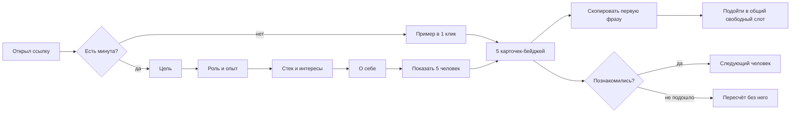

# Шаг 2. Дизайн MeetMatch

> **Роль:** UX/UI-дизайнер · **Дата:** 20 ноября 2026
> **Техники:** карта пользовательского пути, эвристическая оценка по 10 эвристикам Нильсена со шкалой серьёзности 0–4, оценка времени по модели KLM (Keystroke-Level Model), дизайн-токены, проверка контраста по WCAG 2.1 AA, UX-тексты на трёх языках, самокритика «убрать лишнее».
> **Баллы, на которые работает шаг:** «Объяснения и удобство: путь „анкета → результат“ за 2 минуты» (15) и видимость Should-функций (15).

---

## 1. Бриф дизайнера

- **Предмет:** нетворкинг на IT-митапе в Алматы, 300+ человек в зале.
- **Аудитория:** разработчики, рекрутеры, студенты, фаундеры; часть говорит по-казахски.
- **Главная задача экрана:** за минуту заполнить анкету и увидеть, к кому подойти и с чего начать разговор.
- **Где смотрят:** на ноутбуке у стойки регистрации и на телефоне в зале, а на питче — на проекторе.

## 2. Концепция: карточка — это бейдж участника

Самый узнаваемый предмет любого митапа — бейдж на ленте. Поэтому рекомендация оформлена как бейдж:

- **цветная полоса слева — «лента бейджа».** Цвет кодирует пару целей: работа, менторство, кофаундеры, обмен опытом;
- **тот же цвет пары используется на дашборде организатора**, в графике спроса и предложения. Один цветовой язык на весь продукт: цвет несёт смысл, а не украшает;
- **под именем — что человек делает, глазами смотрящего:** «нанимает», «готов менторить» вместо сухого «Нанять».

Это единственный яркий элемент. Всё остальное спокойное: белый фон, тёмно-синий текст, никаких градиентов и теней.

```
┌─────────────────────────────────────────────┐
▌ Dariya Saparova                        78%  │
▌ нанимает                         совпадение │  ← цвет пары «работа»
▌ IT-рекрутер, 7 лет, Ulytau Mobile           │
▌                                             │
▌ Ulytau Mobile нанимает: Backend (junior,    │  ← почему (1–2 предложения)
▌ middle) — это как раз ваша роль. Общий стек…│
▌ [Python] [Django] [PostgreSQL]              │  ← что общего
▌ Первая фраза                                │
▌ ┃ Здравствуйте, Dariya! Я backend-…    [⧉]  │  ← цитата + «копировать»
▌ Оба свободны: 15:30                         │
▌ [ ✓ Познакомились ]  [ ✕ Не подошло ]       │
└─────────────────────────────────────────────┘
```

## 3. Дизайн-токены

Все цвета хранятся в одном файле: [`theme.py`](../theme.py) и тема Streamlit [`.streamlit/config.toml`](../.streamlit/config.toml).

| Токен | Цвет | Где используется | Контраст с белым (WCAG AA ≥ 4.5) |
|---|---|---|---|
| `INK` | `#1B2430` | основной текст | ≈ 15 : 1 ✅ |
| `PRIMARY` «Алатау» | `#12355B` | кнопки, чипы, графики | ≈ 12 : 1 ✅ |
| `MUTED` | `#5B6573` | второстепенный текст | ≈ 6 : 1 ✅ |
| `SURFACE` | `#F2F5F8` | фон полей, цитаты | фон |
| `BORDER` | `#D9E0E7` | рамки | фон |
| Пара «работа» | `#1F6FB2` | лента, подпись, процент | 5.3 : 1 ✅ |
| Пара «менторство» | `#23744A` | лента, подпись, процент | 5.7 : 1 ✅ |
| Пара «кофаундеры» | `#96600F` | лента, подпись, процент | 5.3 : 1 ✅ |
| Пара «обмен опытом» | `#6B4FA0` | лента, подпись, процент | 6.5 : 1 ✅ |

Первые варианты зелёного (`#2E8B57`, 4.3 : 1) и янтарного (`#B7791F`, 3.6 : 1) не прошли проверку контраста. Их затемнили до значений в таблице.

**Шрифт.** Source Sans — он встроен в Streamlit:
- работает без интернета: на площадке Wi-Fi может подвести;
- содержит все казахские буквы: ә, ғ, қ, ң, ө, ұ, ү, һ, і;
- первая фраза набрана им же, а не моноширинным шрифтом: это речь, а не код.

**Скругление:** 0.6rem у всех полей и карточек.

## 4. Пользовательский путь



## 5. Эвристическая оценка (до → после)

Шкала серьёзности Нильсена: 0 — не проблема, 1 — косметика, 2 — мелкая, 3 — серьёзная, 4 — катастрофа.

| # | Эвристика | Что нашли | Серьёзность | Что сделали |
|---|---|---|---|---|
| 1 | Видимость состояния системы | Время подбора и правило взаимности слиты в одну серую строку | 2 | Взаимность — отдельная строка с полосой цвета пары, время — отдельно |
| 2 | Язык пользователя | На карточке цель кандидата «Нанять» — глазами автора анкеты | 2 | Глагол глазами смотрящего: «нанимает», «готов менторить», «ищет работу» |
| 3 | Контроль и свобода | Переключатель языка можно было «отжать» и остаться без языка | 1 | Пустой выбор возвращается к прежнему языку |
| 4 | Единообразие | На дашборде и в карточках разные случайные цвета. Кнопка «Подобрать 5 знакомств» не совпадает с заголовком | 2 | Единая система цветов пар; кнопка «Показать 5 человек» |
| 5 | Предотвращение ошибок | **Цель спрятана в выпадающем списке со значением «Найти работу» по умолчанию.** Жюри может не заметить и получить рекомендации не для своей цели | **3** | Цель — первый вопрос, все 6 вариантов видны сразу |
| 6 | Узнавание вместо вспоминания | Варианты цели не видны без клика | 2 | Варианты в виде переключателей |
| 7 | Гибкость и эффективность | Примеры в 1 клик есть. На телефоне результаты ниже формы, без прокрутки к ним | 2 | Примеры оставили; автопрокрутка — **шаг 6** |
| 8 | Минимализм | 9 полей подряд; моноширинный шрифт в первой фразе читался как код; кнопка Streamlit «Deploy»; разделители «·» | 2 | 6 видимых полей и «Дополнительно» (имя, кого ищете, слоты); цитата обычным шрифтом; служебная панель скрыта; запятые вместо точек |
| 9 | Помощь при ошибках | Предупреждение при пустой анкете есть | 0 | Сообщение при сбое Claude — **шаг 9** |
| 10 | Справка | «Как работает подбор» раскрыт на пустом экране | 0 | Оставили |
| + | Доступность на телефоне | **Язык переключался в боковой панели, которая на телефоне скрыта** | **3** | Переключатель «Қазақша / Русский / English» в шапке |

## 6. Сколько времени займёт путь (модель KLM)

Операторы KLM:
- M — подумать: 1.35 с;
- P — навести мышь: 1.1 с;
- B — клик: 0.1 с;
- K — нажатие клавиши: 0.28 с;
- H — перенести руку на клавиатуру: 0.4 с.

| Путь | Действия | Оценка |
|---|---|---|
| С примером | M + P + B | **≈ 3 с** до результата |
| Вручную, без «о себе» | цель, роль, опыт, 3 тега стека, 1 интерес, кнопка | **≈ 26 с** |
| Вручную, с одной фразой «о себе» (~60 знаков) | то же + текст | **≈ 46 с** |

Требование кейса — 2 минуты, наша цель — 60 секунд. По оценке укладываемся с запасом. **Финальный замер с секундомером делает питчер** (раздел 9).

## 7. Тексты интерфейса (UX writing)

Правила:
- кнопка говорит, что произойдёт;
- одно действие называется одинаково во всём продукте;
- пустой экран подсказывает, что делать дальше.

| Где | Русский | Қазақша | English |
|---|---|---|---|
| Подзаголовок | Пять человек в зале, которым вы нужны так же, как они вам | Залдағы сізбен танысуға мүдделі бес адам | Five people in the room who need you as much as you need them |
| Первый вопрос | Что вы ищете на мероприятии? | Іс-шарада не іздейсіз? | What are you looking for at the event? |
| Кнопка | Показать 5 человек | 5 адамды көрсету | Show 5 people |
| Примеры | Попробовать на примере | Мысалмен көру | Try an example |
| Свёрнутые поля | Дополнительно: имя, кого ищете, свободное время | Қосымша: аты, кімді іздейсіз, бос уақыт | More: name, who you're looking for, free time |
| Пустой экран | Выберите цель и заполните анкету — здесь появятся 5 человек и объяснение, почему стоит подойти к каждому | Мақсатты таңдап, сауалнаманы толтырыңыз — мұнда 5 адам және әрқайсысымен неге танысу керегі пайда болады | Pick a goal and fill in the form — 5 people and why to meet each of them will appear here |
| Подпись цели на карточке | нанимает / ищет работу / готов менторить / ищет ментора / ищет кофаундера / делится опытом | маман іздейді / жұмыс іздейді / тәлімгер болуға дайын / тәлімгер іздейді / кофаундер іздейді / тәжірибе бөліседі | hiring / looking for a job / open to mentoring / looking for a mentor / looking for a co-founder / sharing experience |

## 8. Доступность — чек-лист

- [x] Контраст текста ≥ 4.5 : 1 для всех цветов (раздел 3).
- [x] Цвет — не единственный носитель смысла: цель кандидата написана словами рядом с цветом.
- [x] У всех полей видимые подписи; у переключателя языка — подпись для экранного диктора «Тіл · Язык · Language».
- [x] Фокус с клавиатуры — стандартная обводка Streamlit, не отключена.
- [x] `prefers-reduced-motion` уважается.
- [x] Кнопки «Познакомились» и «Не подошло» во всю ширину колонки — удобно попадать пальцем.
- [x] Ширина 375 px без горизонтальной прокрутки (проверено в браузере).

## 9. Что проверить команде

**Разработчик 2 — визуальное ревью:**
1. Открыть сайт на ноутбуке и на телефоне. Нажать «Соискатель», «Рекрутер», «Студент».
2. Проверить: у карточек одинаковая высота блоков, цвет ленты совпадает с подписью цели и процентом, нет обрезанного текста.
3. Переключить языки — подписи всех полей меняются.

**Питчер — тест с секундомером и вычитка:**
1. Засечь путь «открыл → увидел 5 человек» три раза: с примером, вручную без «о себе», вручную с одной фразой. Записать время сюда:

   | Путь | Попытка 1 | Попытка 2 | Попытка 3 |
   |---|---|---|---|
   | С примером | | | |
   | Вручную без «о себе» | | | |
   | Вручную с фразой | | | |

2. Если владеешь казахским — вычитать раздел 7 и тексты на карточках: объяснения и первые фразы в режиме «Қазақша».

## 10. Что сознательно не делали

- **Свои веб-шрифты.** Риск при плохом Wi-Fi на площадке; встроенный шрифт покрывает казахский.
- **Анимации появления карточек.** Отвлекают на демо и не несут смысла.
- **Тёмная тема.** На проекторе в светлом зале светлая читается лучше.
- **Автопрокрутка к результатам на телефоне и состояния загрузки** — это реализация, переносим на шаг 6 (frontend).
