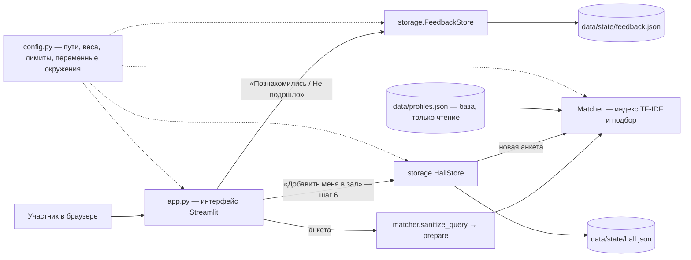

# Шаг 5. Бэкенд: надёжность, живые данные, масштаб

> **Роль:** backend-разработчик · **Дата:** 20 ноября 2026
> **Техники:**
> - конфигурация в одном месте с переопределением переменными окружения (12-factor);
> - проверка входных данных;
> - структурированные логи без персональных данных;
> - атомарная запись файлов и замок для параллельных пользователей;
> - восстановление после повреждённого файла;
> - потокобезопасный индекс (copy-on-write);
> - нагрузочное тестирование;
> - тесты на крайние случаи и гонки потоков.
>
> **Баллы, на которые работает шаг:**
> - работоспособность Must (25) — демо не должно упасть на питче;
> - Should «обратная связь» — отзывы теперь не теряются;
> - запуск через `docker compose up` из условий кейса.

---

## 1. Что было и что стало

| | До | После |
|---|---|---|
| Отзывы «познакомились / не подошло» | в памяти процесса — пропадали при перезапуске | **на диске**, `data/state/feedback.json`, переживают перезапуск |
| Живой зал | не было | **анкета участника добавляется в базу** и видна следующим, `data/state/hall.json` |
| Настройки | пути, веса и лимиты разбросаны по коду | **`config.py`**, переопределяются переменными окружения |
| Входные данные анкеты | принимались как есть | **`sanitize_query`**: неизвестные коды отбрасываются, строки обрезаются, опыт 0–40 |
| Нет или повреждена база | трассировка стека на экране | понятное сообщение, что сделать |
| Повреждён файл отзывов | падение | файл откладывается (`*.corrupt-<время>`), работа продолжается |
| Логи | нет | `startup`, `recommend` (время, число кандидатов), `feedback`, `hall_join` — только id и числа |
| Параллельные пользователи | список дописывался из разных потоков без защиты | замок + атомарная запись + неизменяемые «снимки» индекса |
| Тесты | 36 | **47** |

## 2. Архитектура



- **База анкет (`data/`) только читается.** Живые данные мероприятия пишутся отдельно, в `data/state/`. Эта папка не попадает в git (там личные данные участников), а в Docker лежит на отдельном томе.
- **Один экземпляр `Matcher` обслуживает всех пользователей сразу** (`st.cache_resource`).

## 3. Ключевые решения

### Потокобезопасный индекс (copy-on-write)
Streamlit обслуживает каждого пользователя в отдельном потоке. Если один добавляется в живой зал, пока другой ищет, подбор мог бы увидеть анкету без строки в матрице TF-IDF и упасть.

Поэтому `Matcher` хранит неизменяемый снимок (анкеты, матрица, словарь id):
- `add_profiles` под замком собирает **новый** снимок и подменяет его одной операцией;
- `recommend` берёт снимок один раз в начале.

Тест: 30 добавлений параллельно с 120 подборами в 4 потоках — ни одной ошибки.

### Атомарная запись
Файл пишется во временный рядом и подменяется через `os.replace`. Если процесс упадёт посреди записи, старый файл останется целым. Тест: 8 потоков × 25 записей = 200 записей, ни одна не потеряна, временных файлов не осталось.

### Проверка входных данных
Анкету заполняет любой человек в зале. Поэтому:
- неизвестная роль или цель заменяется значением по умолчанию;
- неизвестные коды стека, интересов и слотов отбрасываются;
- повторы убираются, списки ограничены 12 элементами;
- «о себе» обрезается до 600 символов, имя — до 60;
- опыт ограничен диапазоном 0–40, строка вместо числа не роняет подбор.

Тест: анкеты с мусором — «∞» вместо опыта, 1000 эмодзи, `None` в полях — всё равно дают 5 рекомендаций.

### Логи без персональных данных
Пример (реальный вывод при проверке):
```
INFO meetmatch startup profiles=276 hall=True
INFO meetmatch recommend goal=find_job lang=ru candidates=48 returned=5 excluded=0 ms=2.3
INFO meetmatch feedback action=not_fit candidate=p241 goal=find_job
```
Имён и текстов анкет в логах нет — только цель, язык, id и время.

## 4. Нагрузка (`scripts/benchmark.py` → `reports/benchmark.md`)

| Анкет в базе | Построение индекса | Подбор: медиана | p95 | максимум |
|---|---|---|---|---|
| 276 | 0,04 с | 1,7 мс | 2,3 мс | 2,8 мс |
| 1 000 | 0,13 с | 3,4 мс | 4,3 мс | 4,7 мс |
| 5 000 | 0,63 с | 15,0 мс | 26,0 мс | 31,9 мс |
| 10 000 | 1,71 с | 32,6 мс | 49,9 мс | 87,9 мс |

**Требование кейса — быстрее 3 секунд.** Даже при 10 000 участников в худшем случае подбор занимает 0,09 с — запас больше чем в 30 раз. Время растёт линейно: подбор просматривает каждую анкету. Если однажды понадобится 100 000+, первый шаг — предфильтр по цели через индекс.

## 5. Конфигурация

| Переменная окружения | По умолчанию | Зачем |
|---|---|---|
| `MEETMATCH_DATA_DIR` | `./data` | где лежит база анкет |
| `MEETMATCH_STATE_DIR` | `./data/state` | где хранить отзывы и живой зал; в Docker — том `meetmatch-state` |
| `MEETMATCH_LOG_LEVEL` | `INFO` | подробность логов |
| `MEETMATCH_HALL` | `1` | включить или выключить живой зал |

Веса подбора, штрафы и лимиты анкеты — в [`config.py`](../config.py), с пояснениями.

## 6. Ограничения

- **Файлы, а не база данных.** Для одного мероприятия и одного сервера этого достаточно. Для нескольких серверов нужна общая БД (PostgreSQL), а интерфейс `FeedbackStore` и `HallStore` можно оставить прежним.
- **Streamlit Community Cloud** при повторном деплое начинает с пустой папки `data/state`: живой зал и отзывы обнулятся. Для демо это даже удобно; в Docker данные на томе сохраняются.
- **Словарь TF-IDF строится по базе.** Новые слова из анкет живого зала в него не попадают. На подбор это почти не влияет: текст даёт 11% оценки, а роли, стек и интересы — поля со списками.
- **Кнопки «Добавить меня в зал» в интерфейсе пока нет.** Бэкенд готов (`app.join_hall`), кнопка появится на шаге 6.

## 7. Что проверить команде (разработчик 1 — код-ревью)

Просмотреть новые и изменённые файлы:
- [`config.py`](../config.py);
- [`storage.py`](../storage.py);
- в [`matcher.py`](../matcher.py) — `sanitize_query`, класс `Matcher`, `add_profiles`;
- в [`app.py`](../app.py) — блок «данные» и `join_hall`;
- тесты — [`tests/test_backend.py`](../tests/test_backend.py).

Вопросы для ревью:
1. Все ли поля анкеты проходят через `sanitize_query`?
2. Нет ли места, где живые данные пишутся без замка?
3. Нет ли персональных данных в логах?

Затем:
```bash
python -m pytest -q          # 47 тестов
python scripts/benchmark.py  # нагрузка на вашем ноутбуке
```
